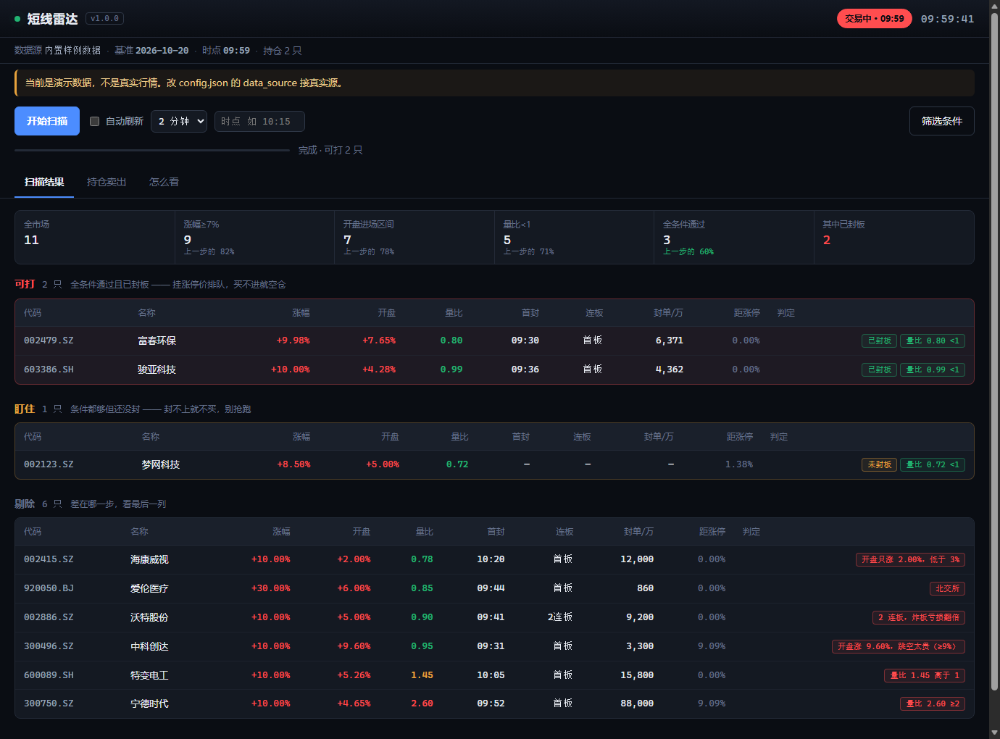
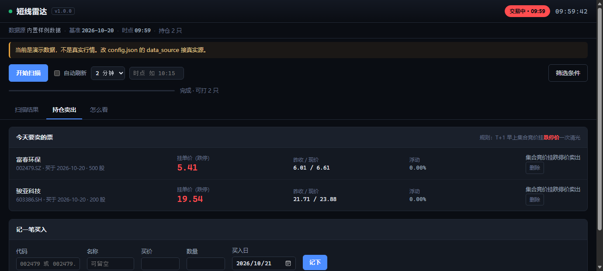

# 短线雷达 Shortline Radar

A 股涨停板扫描器。把「**开盘涨 3~9% + 缩量 + 首板**」这一条筛选条件做成能每天用的工具 —— 本地跑，浏览器看，不依赖任何云服务，也不替你下单。



---

## 它解决什么问题

打板最难的不是判断，是**在一瞬间筛掉不该打的**。这个工具做三件事：

1. **盘中扫全市场**（5,500+ 只，约 25 秒），按六道条件过滤，只剩符合统计优势的几只
2. **告诉你差在哪一步** —— 每只被剔除的票都写明原因，不是简单藏起来
3. **管住卖出** —— 算好跌停价，T+1 早上照单挂出去就行

---

## 先看结论，再看代码

十年全市场日K（1,034 万行 / 5,576 只）回测出来的东西，有些反直觉：

| 结论 | 数字 |
|---|---|
| **打板赚的钱全在隔夜跳空里** | 封住 +2.26%；炸板 **−5.18%**；加权真实期望 **−0.39%**，十年九年在亏 |
| **量比是唯一完全单调的变量** | <0.5 → +5.63%；0.9~1.2 → +2.22%；**≥2 → −1.23%**。无一例外 |
| **最优筛选** | 缩量 + 开盘涨 3~9% → **+4.10% / 胜率 81.9% / 十年 10 正** |
| **无过滤的接力/半路都是负期望** | −0.198% / 胜率 44.3%。越像要涨停越亏，追高 1% 吃掉 1% |
| **半路板靠过滤能翻正（2026-10-22）** | 20cm 触及 5% + 量比≥1.5 + 情绪热 → **+1.73% / 61.0%**，2020~2026 每年为正；对照组 −0.09%，优势全在过滤 ⚠️ 幸存者偏差未解 |
| **连板不值得打** | 炸板亏 10%~11%，而封住只比首板多赚 0.5 个百分点 |

完整推导、每张分档表和 8 条限界见 [docs/STRATEGY.md](docs/STRATEGY.md)。

**一句话记住**：盘中只认一个条件 —— **量比 < 1**；次日只做一个动作 —— **9:25 挂跌停价卖**；买不进只做一件事 —— **放下手机，等下一个**。

---

## 快速开始

需要 Python 3.9+，不装第三方库也能跑（演示模式零依赖）。

```bash
git clone https://github.com/123yyy123-sky/shortline-radar.git
cd shortline-radar
python app.py
```

浏览器会自动打开 <http://127.0.0.1:8848/>。

**第一次跑起来看到的是演示数据**（构造的 11 只票，覆盖所有判定分支）。界面顶部会有橙色提示。想看真实行情，接一个数据源：

```bash
cp config.example.json config.json
# 编辑 config.json，填入行情源
```

Windows 上也可以直接双击 `run.bat`。

想做成一键启动的桌面图标：

```bash
python tools/install_shortcut.py  # 或加 --name "涨停雷达" 自定义名字
```

会在桌面生成**两个**图标：

| 图标 | 动作 |
|---|---|
| 短线雷达 | 双击启动，浏览器自动打开，**不弹黑窗口** |
| 停止短线雷达 | 双击就把后台的服务关掉 |

加 `--force` 覆盖同名文件；加 `--console` 保留控制台窗口（想直接看日志的时候用）。

**为什么没有黑窗口**：有窗口时那个黑框就是服务本体，关掉它服务就停，不关就一直占着任务栏。现在进程在后台静默跑，日志写 `data/app.log`。

**注意一个坑**：无窗口启动后，你调用的每一个命令行工具都会自己弹一个控制台窗口。本程序已经用 `CREATE_NO_WINDOW` 把它堵掉了，如果你自己二次开发时新增子进程调用，记得同样处理，否则黑窗会一直弹。

**它什么时候停**：

- 关掉所有浏览器标签页 → 约 2 分钟后自己退出（`config.json` 的 `web.idle_exit_seconds`，改成 `0` 就常驻不清）
- 想立刻停 → 双击「停止短线雷达」
- 更想常驻 → `python app.py --idle-exit 0`

**启动失败会怎样**：无窗口模式下没有控制台，出错本来是静默的。现在会弹一个系统对话框，直接显示错误原因，同时写进 `data/app.log`。

---

## 数据源

### 方案 A：接自己的行情源（推荐）

软件只需要两样东西：**全市场实时快照** + **涨停池**。默认实现走 `hithink-finance` 命令行工具：

1. 装好 CLI，确认 `hithink-finance symbol list --limit 3` 能返回数据
2. 让它能被找到 —— 以下任选一种：
   - **推荐**：`python tools/make_vendor_shim.py`，自动探测本机 node 和 CLI，
     在 `vendor/` 生成一个写死绝对路径的转发脚本
   - 把可执行文件放进 `vendor/`
   - 设环境变量 `HITHINK_CLI=<路径>`
   - 在 `config.json` 里填 `hithink.cli_path`
3. `config.json` 保持 `"data_source": "hithink"`

> **为什么要用转发脚本**：从资源管理器双击启动时，进程拿到的是系统持久化的
> PATH。node 常常只装在某个带版本的目录里、没进 PATH，于是软件找不到 CLI，
> 一按扫描就报「找不到 hithink-finance」——在终端里手动跑却是好的。
> 转发脚本把 node 和 CLI 的绝对路径写死，就不依赖 PATH 了。
> node 升级换目录后重跑一次即可。

### 方案 B：接别的数据源

扫描只要两个方法。复制 `shortline/datasource.py` 里的 `BaseSource`，实现：

```python
def snapshot(self, codes, progress=None, share=1.0):
    # 返回 list[dict]，每只含 thscode / last_price / open_price / high_price
    # / volume / prev_price

def limit_pool(self):
    # 返回涨停池，至少含 thscode / name / limit_up_time /
    # continue_day_cnt / seal_money / is_st。取不到就返回 []
```

再在 `get_source()` 加一行分支。任何能给出这 11 个字段的源都能接（东财、新浪、自建库皆可）。

### 方案 C：只用演示数据

`config.json` 里设 `"data_source": "demo"`。用来先看界面上手，或者截图。

### 本地数据文件

`data/` 下两个文件，跟着仓库走，不用自己生成：

| 文件 | 内容 | 大小 |
|---|---|---|
| `benchmark.json` | 每只票的前 5 日均量 + 昨收（算量比用） | 163 KB |
| `symbols.json` | 代码 → 名称 | 144 KB |

它们是**某一天的快照**，会随交易日衰减。用久了要重建：

```bash
python tools/build_benchmark.py --panel <你的日K.parquet>   # 需要 duckdb
python tools/build_symbols.py                              # 需要行情 CLI
```

界面会自己检查基准日期，过期会提示。

---

## 按扫描没反应 / 报「找不到 hithink-finance」

先跑自检，它会直接指出是哪一环断了：

```bash
python tools/doctor.py
```

正常输出长这样（`[WARN]` 可以不管，`[FAIL]` 才是问题）：

```
[ OK ] Python 3.11.9
[ OK ] config.json           : data_source=hithink
[WARN] PATH 里的 node       : 没有
[WARN] PATH 里的 hithink CLI : 没有
[ OK ] CLI 实际路径         : ...\vendor\hithink-finance.cmd
[ OK ] 来源                 : vendor/ 转发脚本
[ OK ] CLI 回话             : rc=0 0.1.13
[ OK ] 基准数据             : 5576 只，截至 2026-10-20
```

对照处理：

| 症状 | 原因 | 处理 |
|---|---|---|
| `CLI 实际路径` 那项是 FAIL，提示找不到 hithink-finance | 双击启动的进程 PATH 里没有 node | `python tools/make_vendor_shim.py` |
| CLI 回话 rc≠0 | CLI 自身没登录 / 没配 key | 手动跑 `hithink-finance --version` 排查 |
| 基准数据 asof 太旧 | `data/benchmark.json` 是某天快照 | `python tools/build_benchmark.py` |
| 双击图标闪一下就没了，浏览器没打开 | 端口被上一个实例占着 | 现在会自动接管：打开 `http://127.0.0.1:8848` 就是它在跑 |
| 页面能开，点扫描一直转圈 | 全市场 5,500 只要 30 秒左右 | 等它转完；转超过 2 分钟看 `data/app.log` |
| 双击后完全没反应 | 无窗口模式下看不到报错 | 现在会弹出对话框说明原因；也可以看 `data/app.log` 或跑 `python tools/doctor.py` |
| 一打开就不停弹黑色小窗 | pythonw 没有控制台，每次调命令行工具都会给它新建一个控制台窗口 | 已在 `shortline/datasource.py` 里用 `CREATE_NO_WINDOW` 修掉；自己加子进程调用要照做 |

跑完想确认整条链路通不通，用自带的自检：

```bash
python tools/selftest.py          # 状态 -> 触发扫描 -> 轮询 -> 打印漏斗
```

---

## 界面

三个页面，都用 `?tab=` 可以直接打开。

### 扫描结果

顶部是**漏斗**：全市场 → 涨幅达标 → 开盘达标 → 量比达标 → 全条件 → 已封板。每一步剩多少、转化率多少，一眼能看出今天市场是什么样子。

结果分三组：

- **可打** — 全条件通过且已封板。挂涨停价排队，买不进就空仓
- **盯住** — 条件都够但还没封。封不上就不买，别抢跑
- **剔除** — 每行最后一列写着差在哪一步

点「筛选条件」可以改阈值，保存后自动重扫。默认值就是回测里跑出正期望的那一组，**没看懂之前别动**。

### 持仓卖出



记一笔买入，它会算好 T+1 该挂的跌停价。价格取当天真实昨收，取不到会留空让你手填 —— 不拿旧数据瞎算。

### 怎么看

里面是三条最容易做错的地方，以及卖出和「买不进怎么办」的答案。

---

## 命令行

不想开界面的时候：

```bash
python -m shortline.cli status              # 环境自检
python -m shortline.cli scan                # 扫一次
python -m shortline.cli scan --at 10:15     # 指定时点（回放测试）
python -m shortline.cli scan --json         # 给脚本用
python -m shortline.cli scan --codes        # 只输出 6 位代码，贴进同花顺自选股
python -m shortline.cli scan --codes --sealed-only   # 只要已封板的
python -m shortline.cli scan --mode banlu   # 半路板模式（20cm 触及 5% + 量比≥1.5 + 情绪热）
python -m shortline.cli sell                # 今天要卖的票
```

`--codes` 输出一行一个 6 位代码，可以直接贴进同花顺「自选股 → 导入」。顺序是可打在前、再按量比升序。

**别用问财复现筛选结果。** 问财只有实时量比，没有全天量比，这个组合它算不出来。要名单就用 `--codes` 搬过去，那一步不重算，零误差。怀疑是口径问题时跑：

```bash
python tools/diag_wencai.py
```

它会拿同一份快照按不同口径各算一遍，打三张表：单条件命中数（拿去和问财逐句对）、累积漏斗、两种量比口径下的名单差异。哪条一断崖就是哪条没对上。

`scan` 在发现可打标的时返回退出码 `1`，可以直接接定时任务：

```cron
# 交易日 09:40 / 10:50 / 13:50 各扫一次，有票才推消息
40 9,10,13 * * 1-5  cd /path/to/shortline-radar && python -m shortline.cli scan || \
                    curl -X POST "$WEBHOOK" -d "$(python -m shortline.cli scan --json)"
```

想让它主动推消息，在 `config.json` 填 `notify.webhook_url`（飞书 / 钉钉 / 企业微信机器人都行，会自动识别格式）。

---

## 半路板模式（v1.0.7 新增）

网页左上角切「半路板模式」，或命令行 `--mode banlu`。与打板模式是**两套独立条件，不得互搬**：

| | 打板模式（默认） | 半路板模式 |
|---|---|---|
| 买点 | 涨停价排队 | 20cm 票涨到触发价（昨收 ×1.05）就买 |
| 量比 | **<1**（缩量，封板质量视角） | **≥1.5**（放量，日内延续视角） |
| 出场 | T+1 竞价挂跌停价清光 | 当日封板→次日开盘卖；未封→**当日收盘卖**；跌回触发价→次日清仓 |
| 硬时点 | 09:40 / 10:50 / 13:50 三轮 | **14:30 后停止接新单** |

半路板五条件（缺一不做）：只做 20cm · 开盘未越过触发价 · 量比≥1.5 · 情绪热（全市场涨停≥50 家）· 14:30 前。
扫描建议：触发改不了时点，网页开「自动刷新 60 秒」；手动扫 09:45 / 10:30 / 11:00 / 13:30 / 14:00 / 14:25 六轮。
条件在 `config.json` 的 `banlu_filters` 里改。⚠️ 幸存者偏差未解，攒够 20 笔模拟记录前不上真仓。

---

## 目录结构

```
shortline-radar/
├── app.py                  本地 Web 服务（标准库 http.server）
├── run.bat / run.sh        一键启动（有窗口，方便看日志）
├── stop.bat                命令行版停止脚本（桌面图标用的是 tools/stop.py）
├── config.example.json     配置模板
├── shortline/
│   ├── config.py           配置加载（本机路径全部外置）
│   ├── rules.py            交易规则与判定 —— 改规则只改这里
│   ├── datasource.py       数据源抽象 —— 换行情源只改这里
│   ├── scanner.py          扫描主流程，返回结构化结果
│   ├── holdings.py         持仓与卖出提醒
│   ├── notify.py           可选的消息推送
│   └── cli.py              命令行入口
├── web/                    前端（原生 HTML/CSS/JS，无框架无构建）
├── assets/                 图标（icon.ico 十个尺寸，icon.png 预览）
├── data/                   benchmark.json / symbols.json / demo_snapshot.json
├── vendor/                 本机行情 CLI 转发脚本（生成物，不进版本库）
├── tools/
│   ├── doctor.py           环境自检 —— 扫描跑不起来先跑它
│   ├── selftest.py         端到端自检 —— 状态→扫描→轮询→漏斗
│   ├── diag_wencai.py      问财口径对照 —— 单条件命中数 + 两种量比口径
│   ├── stop.py             按端口停掉后台实例（停止图标调它，无窗口）
│   ├── make_vendor_shim.py 生成 vendor/ 转发脚本（摆脱 PATH 依赖）
│   ├── build_benchmark.py  重建基准数据
│   ├── build_symbols.py    重建简称表
│   ├── make_demo.py        生成演示数据
│   ├── make_icon.py        生成图标
│   └── install_shortcut.py 装桌面快捷方式
└── docs/STRATEGY.md        回测结论与限界
```

设计上把「规则」「数据源」「界面」切成三层：换行情源不动规则，改规则不动界面。

---

## 限界 —— 比结论更重要

这些不是免责套话，是会影响你今天能不能用的实话。

1. **量比口径是近似的。** 回测用「全天量比」，但盘中拿不到全天成交量。本工具用「日内成交量占比曲线」把当前推进率折成全天口径。曲线来自单只股票 5 个交易日的实测，10:00 的真实占比在 23%~37% 之间波动，取的是一个偏保守的固定值。**换成你自己券商的实测值会准很多**（改 `config.json` 的 `intraday_share`）。

2. **早盘大概率筛不到票。** 实测 09:57 全市场 5,574 只里，「涨幅 ≥7% + 开盘 3~9% + 量比 <1」通过 **0 只** —— 早盘本来就是全天最活跃的时段，量比普遍 1.3~1.6。这是策略自身的矛盾，不是 bug。真实执行窗口更可能在午盘之后。

3. **打板的成交概率无法建模。** 一字板占涨停池约 10%，那批期望 +1.91%，比能打到的 −0.47% 还好 —— 越好的越买不进，这是逆向选择。软件只能告诉你「符合条件」，不能保证买得到。

4. **回测没有扣成本。** 印花税、佣金、滑点全都没算。短线换手极高，这块会明显吃掉收益。

5. **数据库不含退市股。** 十年回测存在系统性高估，真实期望比数字更差。

6. **样本期只有十年，且中国股市结构一直在变。** 2018 年 +5.29% 到 2026 年 +2.91%，衰减是可见的。

7. **本工具只做筛选和提醒，不代下单。** 打板要在封板瞬间挂单，机器代办不了，也不该代办。

8. **没有任何一条规则被验证过能穿越牛熊。** 上面所有数字都是历史统计，历史不会简单重复。

---

## 免责声明

本项目是个人研究工具，**不构成投资建议**。股市有风险，短线交易的风险尤其大。所有默认参数来自历史回测，不对未来收益作任何承诺。请自行判断，自负盈亏。作者不对使用本工具造成的任何损失负责。

验证期请用最小仓位或模拟盘。

---

## License

MIT
